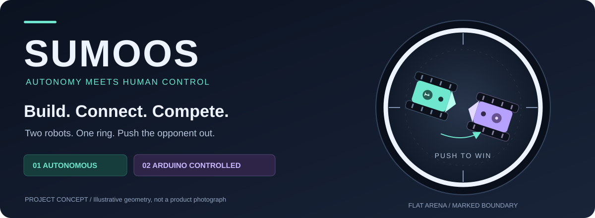

# Sumoos

[Website](https://sumoos.vercel.app) · [Pitch PDF](docs/Sumoos_Pitch.pdf) · [Task board](https://github.com/JeroenMarkusVermeulen/Sumoos/issues) · [Dashboard setup](dotnet/README.md)

**Two robots. One ring. One objective: push the opponent outside the boundary.**

Sumoos is a student robotics project that brings together embedded programming, a physical
Arduino controller, a .NET desktop application, MQTT communication and a business website.
Our first version pits **one autonomous robot against one manually controlled robot** on
a flat, marked arena.

The autonomous robot should find its opponent and drive toward it. A player drives the
manual robot using an Arduino MKR handheld controller. Both robots need local boundary
detection to reduce accidental exits. Being pushed out by the opponent is still how a robot
loses; boundary protection cannot guarantee that a robot stays inside.

## What we are building

| Part | Purpose |
| --- | --- |
| Autonomous robot | Detect the opponent, search, approach and push without steering from a player. |
| Manual robot | Receive drive commands through a Raspberry Pi USB bridge or MKR UART bridge. |
| Arduino controller | Read tilt and buttons on the MKR handheld and send commands over USB serial. |
| .NET Control Room | Connect the controller and broker, forward commands, and show useful diagnostics. |
| Docker + MQTT | Run the local message broker connecting the laptop to the robot bridge. |
| Website | Explain the project, team and idea to visitors. It is separate from robot control. |

The learning goal is to make these parts work reliably together, then demonstrate a match.
The first milestone is a safe, repeatable local demonstration.

## Current status

| Component | Available in this repository | Still to do |
| --- | --- | --- |
| Windows dashboard | Styled WPF UI, simulation pad, connection settings, motor intent, packet inspector and exportable logs. | Test against the actual Arduino and robots. |
| .NET gateway | Serial input validation, MQTT publishing, arming, speed limiting and input timeout. | Complete firmware integration and measure real behavior. |
| Software checks | Controller and feedback checks, Docker integration tests and a WPF startup/shutdown smoke test. | Physical connection-loss, boundary and match tests. |
| MQTT infrastructure | Docker Compose and password-protected Mosquitto configuration. | Create a local password file and verify the project network. |
| Website | Source and Vercel build configuration; [website link](https://sumoos.vercel.app). | Continue the business content as the project develops. |
| Controller and robot | [MKR and Zumo 32U4 sketches](Arduino), [Pi bridge](Pi/README.md) and [protocol](dotnet/docs/protocol.md). | Bench integration, calibration and Zumo telemetry. |

**Working software checks do not prove that the physical robots are ready.** Hardware
purchase/assembly and an end-to-end match have not been confirmed. No measured detection
range, radio latency, pushing force or win rate is claimed.

## How the system fits together

### Manual robot

1. The Arduino reads the player's controls and sends newline-terminated commands over USB.
2. The .NET application validates the input and applies the configured speed limit.
3. It publishes fresh, non-retained commands to the MQTT broker running in Docker.
4. The Raspberry Pi receives the commands over Wi-Fi and forwards fresh commands to the Zumo 32U4 over USB. It publishes bridge readiness back to the dashboard.
5. The MKR Wi-Fi bridge is also available. It sends commands to the Zumo 32U4 over UART.

### Autonomous robot

Opponent detection, search/attack decisions and boundary handling run **on the robot**.
The autonomous robot does not need the other robot to transmit its position.

The dashboard runs on the laptop. Docker hosts the broker. Vercel hosts the informational
website. The initial design keeps robot control on the local network.

## Try the dashboard without hardware

You need **Windows and the .NET 8 SDK** for the current WPF application. VS Code or Visual
Studio can be used for development. Docker and robot hardware are unnecessary for simulation.

Clone the repository, then run these commands in PowerShell:

    git clone https://github.com/JeroenMarkusVermeulen/Sumoos.git
    cd Sumoos
    dotnet run --project dotnet/src/Sumoos.Dashboard

In the dashboard:

1. Keep **Simulation** selected and click **Start session**.
2. With the controls neutral, click **Arm simulation**.
3. Hold a directional button to drive; release it to return to neutral.
4. Use **Stop motors** to disarm.
5. Select **Pause input** to test the input-loss timeout. Resume input and explicitly re-arm afterward.
6. Open **Input and packet** to inspect the latest input, outgoing JSON, frame count and errors.

The simulation pad sends no commands to a physical robot. The dashboard's motor values show
**outgoing intent**, not measured wheel movement. Switching away from the window requests
a stop. Logs show session events and faults; the last 500 entries can be exported.

For Visual Studio, open [Sumoos.sln](dotnet/Sumoos.sln), select **Sumoos.Dashboard** as the
startup project and press **F5**. For configuration and the optional console application,
see the [.NET guide](dotnet/README.md).

## Connect real hardware

### Checked-in hardware paths

| Item | Quantity | Role |
| --- | --- | --- |
| Pololu Zumo 32U4 | 1 manual robot | Tracked robot with the checked-in serial receiver sketch. |
| Raspberry Pi with Wi-Fi or Arduino MKR bridge | 1 bridge | Wi-Fi to USB serial on the Pi or Wi-Fi to UART on the MKR. |
| Arduino MKR handheld | 1 controller | Physical tilt and button input over USB. |
| Windows laptop | 1 | .NET dashboard and Docker MQTT broker. |
| Battery sets, charger, USB cables, headers and mounting hardware | As required | Power, programming and secure connections. |
| Local Wi-Fi network and a flat marked arena | 1 of each | Communication and the fighting area. |

Use the [Pi setup](Pi/README.md) or the [MKR bridge sketch](Arduino/ZumoBridge/ZumoBridge.ino)
for the relevant board and link. The [original hardware plan](docs/Sumoos_Project_Information.txt)
describes the earlier Zumo 2040 and ESP32 proposal.

### Start the broker

Install Docker Desktop and start it. Run these commands from the **repository root**.

On the **first setup only**, create the password file required by the existing configuration:

    docker compose -f infrastructure/compose.yaml run --rm --no-deps broker mosquitto_passwd -c /mosquitto/config/passwords sumoos

Enter a local password when prompted. The generated password file is gitignored.
The -c option creates/replaces the password file; omit it when adding a user to an existing file.

Then start and inspect the broker:

    docker compose -f infrastructure/compose.yaml up -d
    docker compose -f infrastructure/compose.yaml logs -f broker

Configure the dashboard with the same username/password and the Arduino's USB port.
Use localhost for the dashboard if Docker runs on the same laptop. Configure the bridge
with the laptop's **LAN address**. Verify device-to-device access on the actual
Wi-Fi network; school networks can isolate clients.

The initial broker uses authenticated, plaintext MQTT on port 1883 for a trusted LAN.
Do not expose it to the public internet or commit passwords/Wi-Fi credentials.

Before live driving, verify the wired and wireless links against the
[protocol contract](dotnet/docs/protocol.md). Disconnect the dashboard session, deselect
**Simulation**, choose the live bridge and start the session. The physical MKR controller
arms and drives the robot. See [dashboard setup](dotnet/README.md) for feedback and diagnostics.

## Control rules and safety

| Rule | Current software behavior / firmware requirement |
| --- | --- |
| Start stopped | The gateway starts disarmed. Reconnection does not automatically resume motion. |
| Deliberate arming | A fresh neutral input must precede an explicit ARM command. |
| Input scale | Left/right commands are signed percentages from -100 to 100. Default speed limit: 30%. |
| Fresh input | The gateway expects input about every 50 ms and disarms after 250 ms without fresh valid input. |
| Invalid input | Malformed or out-of-range input disarms the gateway. |
| No replay | MQTT drive messages use QoS 0, retain=false and no application offline queue. |
| Local protection | Zumo firmware must implement its own command-loss watchdog and boundary override. |
| Stop delivery | The dashboard requests a stop; it cannot guarantee delivery after a lost connection or killed process. |

The [protocol document](dotnet/docs/protocol.md) defines the current software message
format, topic, expiry and sequence rules. Use it for firmware integration; older examples
in the planning notes describe earlier proposals.

Before a match, test with tracks lifted and low speed. Verify motor directions, stop,
controller unplugging, broker/Wi-Fi loss, board reset, re-arming and boundary detection
against the real arena. Autonomous decisions and boundary checks stay local to the Zumo.

## Repository guide

| Location | Contents |
| --- | --- |
| [dotnet/](dotnet/) | All .NET application code, solution, tests and application setup guide. |
| [dotnet/src/Sumoos.Dashboard/](dotnet/src/Sumoos.Dashboard/) | Windows WPF interface and display view model. |
| [dotnet/src/Sumoos.Controller/](dotnet/src/Sumoos.Controller/) | Console entry point, configuration, serial/MQTT adapters and dashboard session service. |
| [dotnet/src/Sumoos.Core/](dotnet/src/Sumoos.Core/) | Hardware-independent validation, arming and timeout logic. |
| [dotnet/tests/](dotnet/tests/) | Executable automated software checks. |
| [infrastructure/](infrastructure/) | Docker Compose and Mosquitto configuration. |
| [Arduino/](Arduino/) and [Pi/](Pi/) | Controller and Zumo sketches, plus the MKR and Raspberry Pi bridges. |
| [website/](website/) | Business website source and Vercel configuration. |
| [docs/](docs/) | Pitch, requirements, planning notes and project diagrams. |
| [.github/workflows/dotnet.yml](.github/workflows/dotnet.yml) | Clean build, automated checks and dashboard startup/shutdown smoke test. |

### Build and check the software

From the repository root:

    dotnet build dotnet/Sumoos.sln --configuration Release
    dotnet run --project dotnet/tests/Sumoos.Checks --configuration Release --no-build

[GitHub Actions](https://github.com/JeroenMarkusVermeulen/Sumoos/actions/workflows/dotnet.yml)
also runs these checks on Windows and launches the actual WPF window for a startup/shutdown
smoke test. These checks cover software logic and local MQTT framing, not physical robot performance.

### Website development

The website is built separately from the .NET application:

    npm --prefix website run build

Use Node.js 22 or newer. The build generates static pages from the supported PHP
includes; Vercel does not run arbitrary PHP here. Deployment settings and routes are
documented in [website/DEPLOYMENT.md](website/DEPLOYMENT.md).

## Team

| Team member | Main responsibility |
| --- | --- |
| Oliver | Autonomous robot: opponent detection, searching and attacking. |
| Vlad | Arduino controller for the manual robot. |
| Ramazan | Business website and About Us page. |
| Jeroen | .NET dashboard, controller input and MQTT communication. |
| Everyone | Agree interfaces, integrate components, test and demonstrate the match. |

Track detailed work and assignments in [GitHub Issues](https://github.com/JeroenMarkusVermeulen/Sumoos/issues).

## Requirements and next milestones

**Must:** two driving robots; autonomous detection/approach/pushing; manual Arduino
control; local boundary protection; stop and connection-loss handling; the .NET
communication application; and a project website.

**Should:** clear operating-state indicators, adjustable test speed and useful diagnostics.

**Could:** browser-based driving, a match timer, scoring and recorded results. These are
future extensions. The current desktop simulation pad does not replace the Arduino controller.

The next integration milestones are:

1. Confirm hardware variants, arena and match rules.
2. Bench-test the MKR controller, selected bridge and Zumo firmware against the agreed protocol.
3. Demonstrate low-speed driving through the complete manual-control chain.
4. Calibrate autonomous opponent detection and boundary protection.
5. Pass disconnect/reset tests, then run a controlled match.

## Project documents

- [Pitch preview (PDF)](docs/Sumoos_Pitch.pdf)
- [Download the editable PowerPoint](https://github.com/JeroenMarkusVermeulen/Sumoos/raw/refs/heads/main/docs/Sumoos_Pitch.pptx)
- [Requirements list (PDF)](docs/Requirements%20list%20Sumoos.pdf)
- [Hardware and project planning notes](docs/Sumoos_Project_Information.txt)
- [Document index](docs/README.md)

The pitch presents the original project idea. This README and the application/protocol
guides describe the current software. The diagrams are original concept illustrations,
not photographs or wiring diagrams. Licensing information is in [docs/LICENSE](docs/LICENSE).

## Hardware-free Docker milestone

See [simulation/README.md](simulation/README.md) for the separate MQTT broker, robot simulator,
status feedback and deliberate restart tests. In the dashboard select Simulation plus
Use Docker MQTT simulator to select `127.0.0.1:1884` and the simulation credentials.
The simulator reports virtual motor percentages, not physical motion or sensor measurements.
